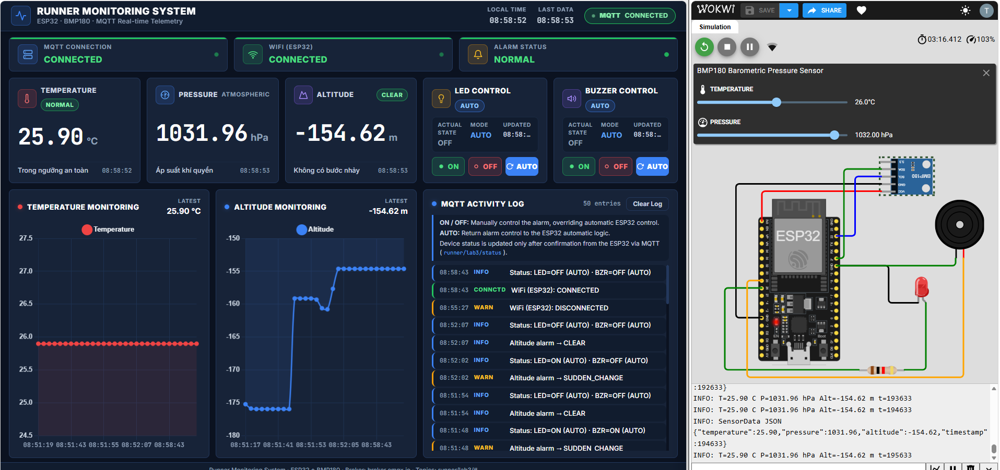
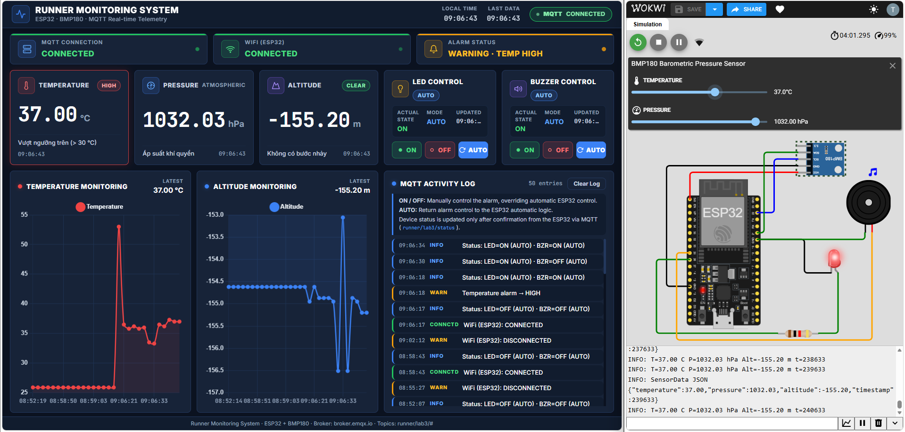
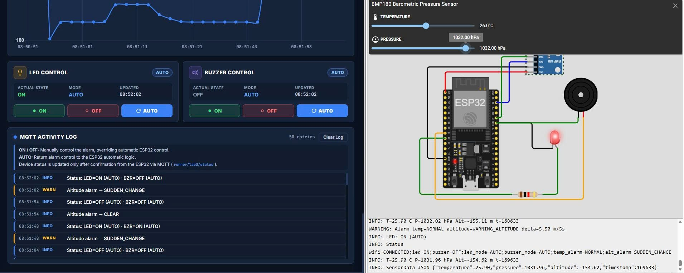
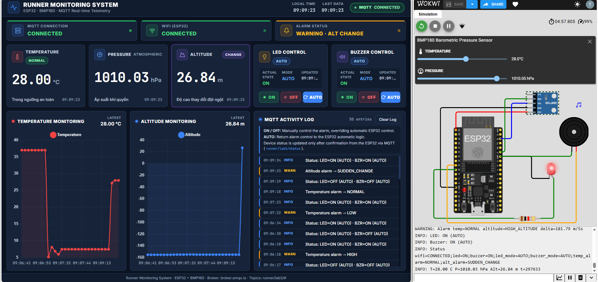

# Lab 3 - Hệ thống nhúng - Đề 1

## Bước 1: Mở web và Wokwi từ link

- Link web: https://nttrungdtvt1.github.io/Lab3_He_Thong_Nhung_msv231432378/
- Link Wokwi: https://wokwi.com/projects/480532359100668929

## Bước 2: Nạp firmware trên Wokwi

Tại trang Wokwi, ở mục `sketch.ino`, chọn một dòng bất kỳ. Nhấn tổ hợp phím `Fn + F1`, tìm **upload Firmware and Start Simulation**, sau đó chọn file `Lab3_De1.ino.bin` trong thư mục `build\esp32.esp32.esp32\Lab3_De1.ino.bin`.

## Bước 3: Chạy mô phỏng

### TEST CASE 1

Thiết lập nhiệt độ trong khoảng 10 °C ≤ T ≤ 32 °C và áp suất không đổi.

### TEST CASE 2

Thiết lập nhiệt độ trong khoảng 32 °C ≤ T ≤ 35 °C và áp suất không đổi.

### TEST CASE 3

Thiết lập nhiệt độ trong khoảng 35 °C < T và áp suất không đổi.

Thiết lập nhiệt độ trong khoảng (T < 10 °C hoặc T > 35 °C) và áp suất không đổi.

### TEST CASE 4

Thiết lập nhiệt độ trong khoảng 10 °C ≤ T ≤ 32 °C và áp suất đổi từ 1032.75 xuống 1032.00 trong vòng 5 giây.

### TEST CASE 5

Thiết lập nhiệt độ trong khoảng 10 °C ≤ T ≤ 32 °C và áp suất đổi từ 1032.75 xuống 1010.00 trong vòng 5 giây.

### TEST CASE 6

Thiết lập nhiệt độ hoặc áp suất làm cảnh báo rồi dùng button ở chế độ manual để bật/tắt tùy chọn.
